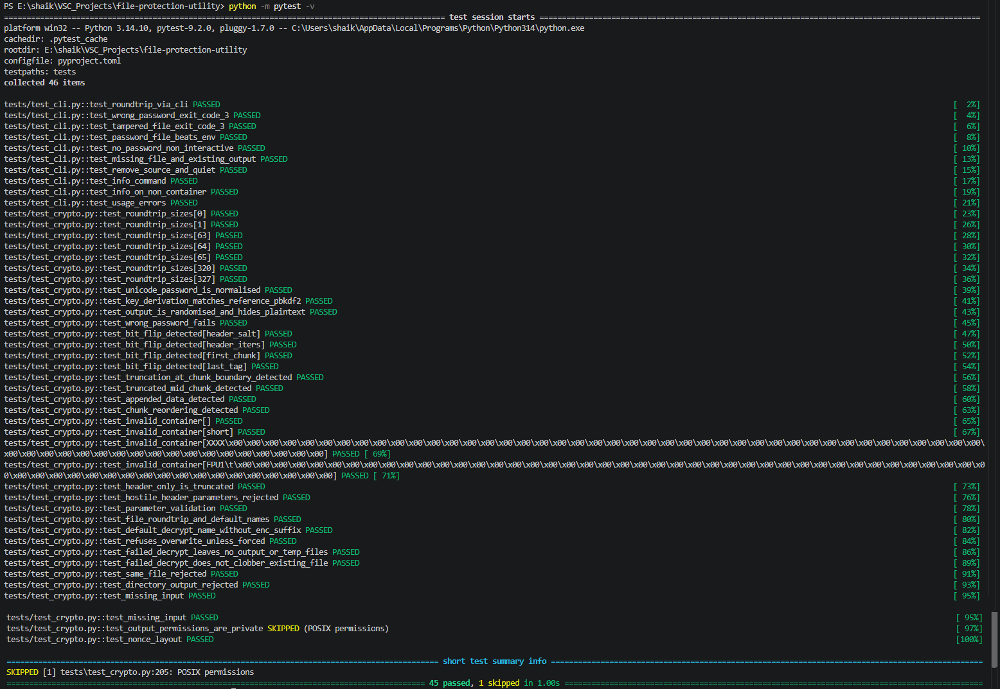
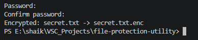
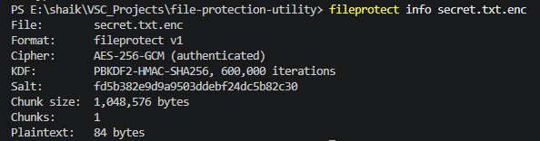
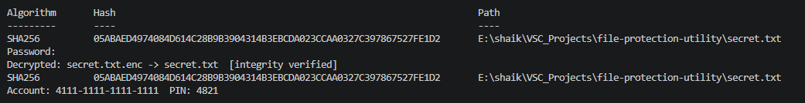
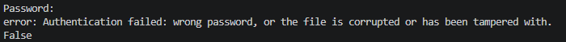
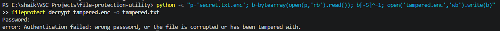

# File Protection Utility (`fileprotect`)

A small, dependency-light command-line tool that encrypts and decrypts local files with
**AES-256** and derives the key from a password with **PBKDF2-HMAC-SHA256** (random salt).
Decryption verifies a **MAC (GCM authentication tag)** on every chunk, so a wrong password,
corruption, truncation or tampering is always detected - and never produces an output file.

| Requirement                     | Implementation                                                          |
|---------------------------------|-------------------------------------------------------------------------|
| Standard crypto library         | Python [`cryptography`](https://cryptography.io) (OpenSSL backend)      |
| AES-256 symmetric encryption    | AES-256-GCM (authenticated encryption)                                  |
| PBKDF2 with salt                | PBKDF2-HMAC-SHA256, 600,000 iterations, 128-bit random salt per file    |
| Ciphertext output `.enc`        | `secret.txt` -> `secret.txt.enc`                                        |
| Decrypt verifying MAC integrity | GCM tag checked per chunk; exit code 3 on failure; nothing is written  |

## Install

Requires Python 3.9+.

```bash
python -m pip install .            # installs the `fileprotect` command
# or run without installing:
python -m pip install -r requirements.txt
python filecrypt.py --help
```

## Usage

```bash
fileprotect encrypt secret.txt                 # -> secret.txt.enc  (prompts for password twice)
fileprotect decrypt secret.txt.enc             # -> secret.txt      (verifies integrity first)
fileprotect decrypt secret.txt.enc -o out.txt  # custom output
fileprotect info    secret.txt.enc             # show cipher/KDF parameters (no password needed)
```

| Option               | Applies to       | Description                                              |
|----------------------|------------------|----------------------------------------------------------|
| `-o, --output PATH`  | encrypt/decrypt  | Output path (default: add / strip `.enc`)                |
| `-f, --force`        | encrypt/decrypt  | Overwrite an existing output file                        |
| `--password-file P`  | encrypt/decrypt  | Read the password from a file (trailing newline removed) |
| `--remove-source`    | encrypt/decrypt  | Delete the input after success (plain delete, not a secure wipe) |
| `--iterations N`     | encrypt          | PBKDF2 iterations (min 100,000; default 600,000)         |
| `--chunk-size BYTES` | encrypt          | Streaming chunk size (default 1 MiB)                     |
| `-q, --quiet`        | encrypt/decrypt  | No informational output                                  |

**Password sources** (first match wins): `--password-file`, the `FILEPROTECT_PASSWORD`
environment variable, then an interactive hidden prompt. There is intentionally no
`--password VALUE` flag, because command-line arguments leak via shell history and `ps`.

**Exit codes:** `0` success - `1` error (missing file, bad format, output exists, ...) -
`2` usage error - `3` authentication failure (wrong password or tampered data).

### As a library

```python
from fileprotect import encrypt_file, decrypt_file

enc = encrypt_file("report.pdf", None, "my passphrase")      # Path("report.pdf.enc")
out = decrypt_file(enc, "report.copy.pdf", "my passphrase")
```

## Verification

```bash
python -m pip install -e ".[dev]"
python -m pytest        # 46 tests: round-trips, wrong password, bit flips, truncation, reordering...
                        # (45 pass + 1 skipped on Windows: the POSIX file-permission test)
bash scripts/demo.sh    # end-to-end run on Linux/macOS/WSL
```

Execution screenshots are below. Text logs from a Linux run of the test suite and demo script are in
[`docs/verification/`](docs/verification/).

## Verification Screenshots

Captured on Windows / PowerShell with Python 3.14 (also available in [`screenshots/`](screenshots/)).

### 1. Test suite - 45 passed, 1 skipped
Covers round-trips for many file sizes, wrong password, bit flips, truncation, chunk reordering and invalid containers.
The single skip is the POSIX file-permission test, which does not apply on Windows.



### 2. Encrypting a file (PBKDF2 key derivation + AES-256-GCM)
`fileprotect encrypt secret.txt` prompts for a password (hidden) and a confirmation, then writes `secret.txt.enc`.



### 3. Container metadata
`fileprotect info secret.txt.enc` shows AES-256-GCM, PBKDF2-HMAC-SHA256 with 600,000 iterations, and the random per-file salt.



### 4. Decryption with integrity verified
The original file is hashed and deleted, then decrypted. The SHA-256 hashes before and after are identical,
so the file was restored byte for byte.



### 5. Wrong password rejected
MAC verification fails with an authentication error and no output file is created (`Test-Path` prints `False`).



### 6. Tampered ciphertext rejected
One bit of the `.enc` file is flipped. Even with the correct password, decryption fails authentication.



## How it works

See [`SECURITY.md`](SECURITY.md) for the container format, threat model and limitations.

```
password --PBKDF2-HMAC-SHA256(salt, 600k)--> 256-bit key
plaintext --[1 MiB chunks]--> AES-256-GCM(nonce = prefix||counter||final, AAD = header) --> header || chunk_1 || ... || chunk_n
```

## Project layout

```
src/fileprotect/crypto.py   container format, KDF, streaming encrypt/decrypt, atomic file output
src/fileprotect/cli.py      argparse CLI, password handling, exit codes
filecrypt.py                run-from-checkout launcher
tests/                      pytest suite (library + CLI)
scripts/demo.sh             end-to-end verification demo (Linux/macOS/WSL)
screenshots/                execution screenshots (embedded above)
```

## License

MIT
